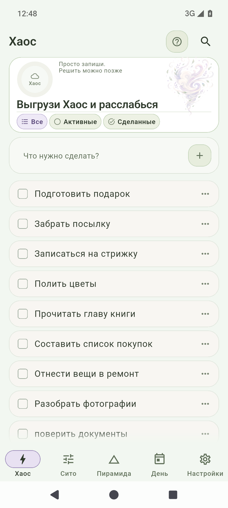
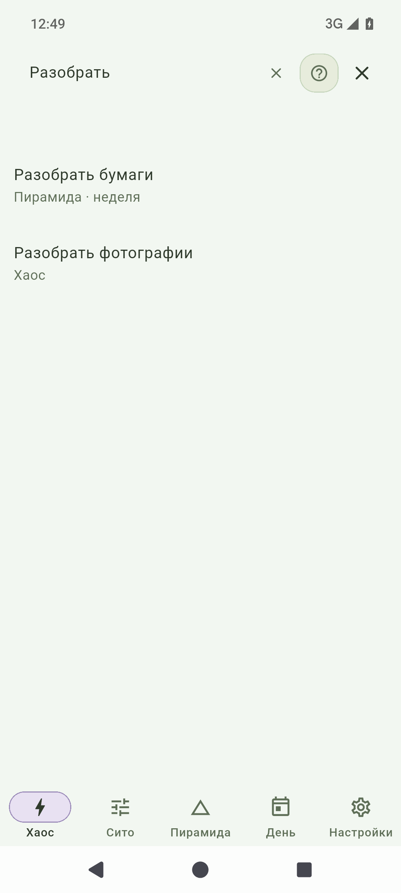
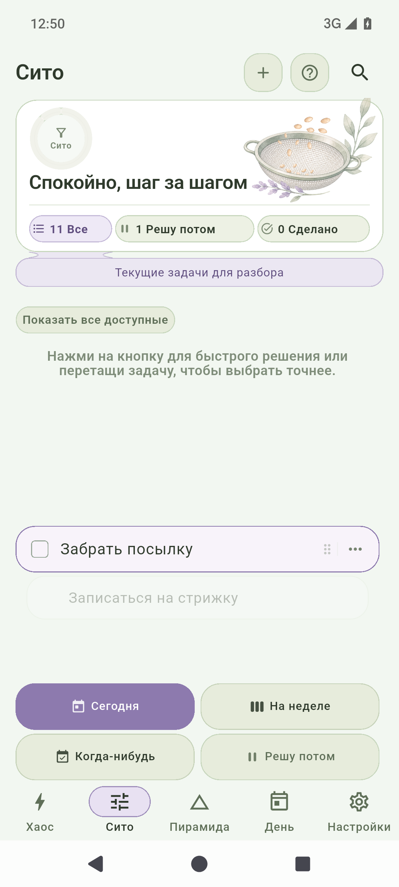
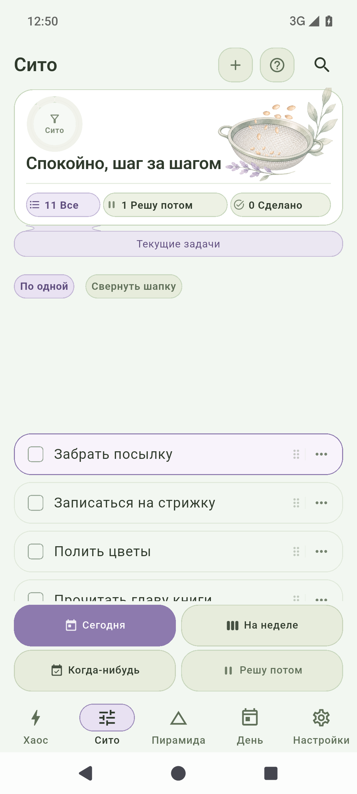
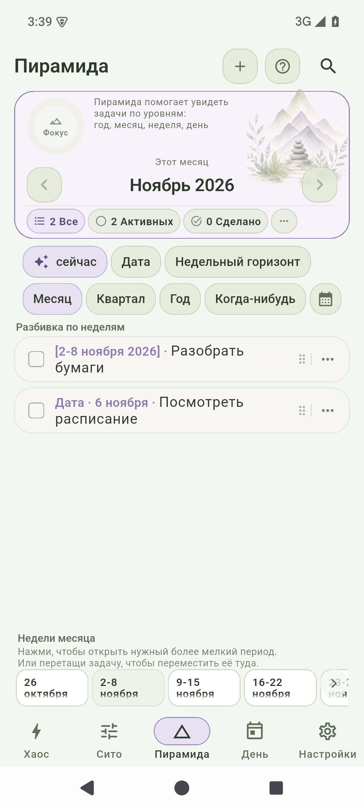
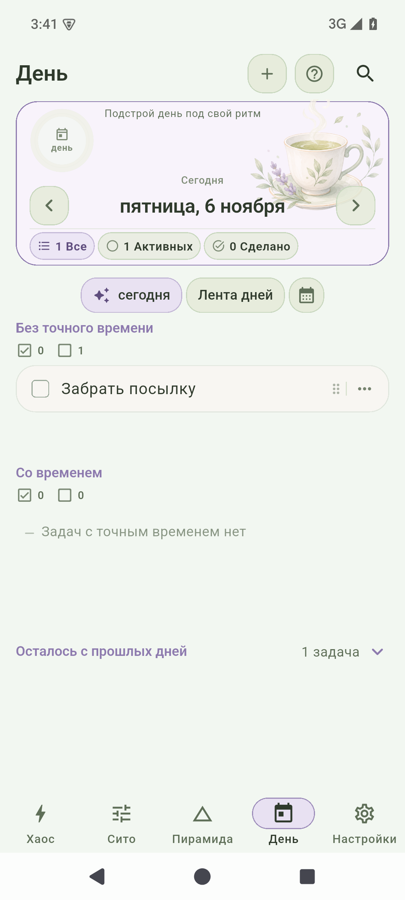

# Хаос по местам

> **Не всё сразу, но всё по силам.**

«Хаос по местам» — спокойный планировщик для тех случаев, когда дел слишком много, а сил сразу разложить всё по датам и приоритетам нет.

Здесь необязательно заранее строить идеальный план. Сначала можно просто выгрузить всё из головы, затем разбирать задачи по одной или просматривать полный список и постепенно уточнять, когда ими заниматься.

## Скачать приложение

Сейчас доступна бета-версия для Android:

[**Скачать «Хаос по местам» 1.0.0-beta.1 (build 40)**](https://github.com/NoveltiL/haospomestam-releases/releases/download/v1.0.0-beta.1%2B40/haos-po-mestam_1.0.0-beta.1%2B40.apk)

Перед обновлением создай резервную копию задач в «Настройках» → «Безопасность данных» → «Создать копию» и сохрани файл вне приложения.

Контрольная сумма файла:

[Посмотреть SHA256SUMS.txt](https://github.com/NoveltiL/haospomestam-releases/releases/download/v1.0.0-beta.1%2B40/SHA256SUMS.txt)

## Как это работает

### Хаос — сначала просто запиши

Не нужно сразу выбирать дату или время. Быстро добавляй дела, чтобы больше не удерживать их в голове. Нужную задачу можно найти поиском.

 

*Первый кадр — быстрый ввод и список задач; второй — поиск по части названия.*

### Сито — разбирай задачи в своём темпе

В «Сите» можно разбирать задачи «По одной» или просматривать полный список. Вверху переключаются разделы «Все», «Решу потом» и «Сделано». Для выбранной задачи можно решить, что делать дальше:

- сделать сегодня;
- запланировать на неделю;
- оставить на когда-нибудь;
- отложить решение и вернуться позже.

 

*Первый кадр — разбор по одной задаче; второй — полный список с выбранной задачей и переключателями разделов.*

### Пирамида — планируй с подходящей точностью

Не каждому делу нужна точная дата. Задачу можно отнести к нужному горизонту:

- конкретный день;
- неделя;
- месяц;
- квартал;
- год;
- когда-нибудь.

По мере приближения дела план можно постепенно уточнять. Задачи также можно переносить между периодами перетаскиванием.

*В одном месяце видны задачи на неделю и на конкретную дату.*

### День — только то, что важно сейчас

В «Дне» собраны задачи на выбранную дату. На сегодняшнем экране незавершённые дела с предыдущих дат ненавязчиво появляются ниже обычных задач в отдельном сворачиваемом блоке. Их исходная дата сохраняется, пока ты сам не перенесёшь задачу.

Точное время можно назначить только тем делам, которым оно действительно нужно. Остальные останутся в списке без жёсткого расписания.

Выполненные задачи остаются видимыми, а последние действия при необходимости можно отменить.

 

*Первый кадр — задача на сегодня и свёрнутый блок; второй — раскрытый блок с задачей под её прежней датой.*

## Что уже умеет приложение

«Хаос по местам» помогает сначала выгрузить мысли в Хаос, затем спокойно разобрать задачи по одной или в полном списке и планировать только то, что действительно нужно.

### Записать и разобрать

- Быстро добавляй задачи в «Хаос» без обязательной даты, времени или периода.
- Находи задачи поиском по названию или описанию.
- Просматривай все, активные или сделанные задачи; открывай подробности и редактируй название и заметку.
- В «Сите» выбирай режим «По одной» или полный список и переключайся между разделами «Все», «Решу потом», «Сделано».
- Для помощи с отложенными задачами есть «Матрица» с осями важности и срочности. Из её ячеек можно переносить задачи на выбранный горизонт.

### Планировать время

- Назначай задачи на сегодня, завтра или выбранную дату.
- Планируй по горизонтам: «Неделя», «Месяц», «Квартал», «Год» и «Когда-нибудь».
- В «Пирамиде» выбирай периоды, переходи между горизонтами и переноси задачи перетаскиванием.
- В «Дне» смотри задачи выбранной даты, переключайся между обычным списком и лентой, просматривай задачи с точным временем и без него, меняй дату или время перетаскиванием и через меню.
- Если перенос может убрать назначенную дату или точное время, приложение сначала просит подтвердить решение.

### Завершать и возвращать

- Отмечай задачи сделанными и при необходимости возвращай их в работу.
- Отправляй задачи в Архив или Корзину.
- Восстанавливай задачи из Архива или Корзины в Хаос либо в сохранённое место.
- Отменяй последнее действие, когда доступна кнопка отмены: например, перемещение, отправку в Архив или Корзину. В текущей версии не каждое действие можно отменить.

### Настроить внешний вид

- Выбирай системный, светлый или тёмный цветовой режим.
- Переключайся между стандартным и Minimal-оформлением в светлой и тёмной теме.
- Выбирай обычный или компактный вид верхнего информационного блока.
- Чтобы упростить навигацию, скрывай Сито или Пирамиду — задачи при этом остаются на месте.
- Меняй порядок отображения уровней Пирамиды — планы и сами задачи при этом не меняются.

### Сохранить данные и получить помощь

- Сохраняй резервную копию задач в файл.
- Добавляй из копии новые задачи без замены существующих или полностью восстанавливай данные после предварительного просмотра и подтверждения.
- Настройки оформления не входят в резервную копию.
- Приложение работает с локальными данными и не требует аккаунта.
- Открывай встроенную справку, пиши в поддержку из Настроек и при необходимости прикладывай технический лог к письму.

## От хаоса к плану

Короткая демонстрация всего пути: от быстрой выгрузки задач из головы до спокойного и понятного плана дня.

> Видео записано на одной из предыдущих бета-версий приложения. Некоторые элементы интерфейса уже изменились. К следующему релизу планирую подготовить обновлённую демонстрацию.

https://github.com/user-attachments/assets/78e617f8-cec4-4c22-aaac-9b103eb53c97

## Установка

1. Скачай APK по ссылке выше или из раздела **Assets** последнего релиза. [**Перейти к файлам релиза в разделе Assets**](https://github.com/NoveltiL/haospomestam-releases/releases/tag/v1.0.0-beta.1%2B40#release-assets)
2. Открой загруженный файл на Android-устройстве.
3. Если система попросит разрешение на установку из браузера или файлового менеджера, предоставь его для выбранного приложения.
4. Подтверди установку.

При обновлении устанавливай новую версию поверх существующей. Предварительно сохрани данные в резервную копию. Не удаляй приложение перед обновлением!

## Системные требования и статус

- Android 7.0 или новее — заявленное минимальное требование сборки.
- Ранее опубликованные beta-сборки вручную проверялись на реальных устройствах: Samsung Galaxy Note10+ с Android 12; Samsung S7 Edge с Android 8, Vivo X300 с Android 16.
- Обновление beta.39 → beta.40 поверх установленного приложения проверено с сохранением демонстрационных задач на изолированном AVD с Android 15 / API 35. Это проверка одного сценария, а не всех Android-устройств.
- Отдельное тестирование на Android 7.0 / API 24 пока не выполнялось.

Приложение находится на стадии бета-тестирования и может содержать ошибки. Перед обновлением сохрани актуальную резервную копию данных.

## О репозитории

Этот публичный репозиторий предназначен для готовых Android-сборок, контрольных сумм и презентационных материалов приложения.

Исходный код приложения здесь не публикуется.
